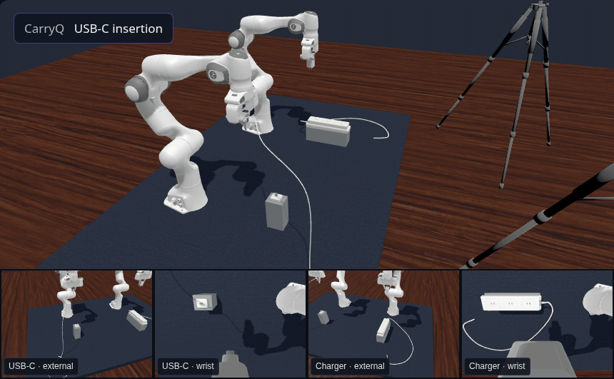

<div align="center">

<a href="https://nebulis-lab.com/CarryQ/">
  
</a>

# Beyond Pointwise Accuracy: Temporal Error Structure in Robot Action Tokenization

### CarryQ · Temporal Residual-Feedback Action Encoding

Shuaijun Liu · Feiyang You · Chenglong Zhang · Ningxin Su<sup>✉</sup><br>
The Hong Kong University of Science and Technology (Guangzhou)<br>
<sup>✉</sup> Corresponding author: [ningxinsu@hkust-gz.edu.cn](mailto:ningxinsu@hkust-gz.edu.cn)

[](https://nebulis-lab.com/CarryQ/)
[](https://github.com/NEBULIS-Lab/CarryQ/actions/workflows/tests.yml)
[](#installation)
[](LICENSE)
[](#paper)

[**Project website & interactive demo**](https://nebulis-lab.com/CarryQ/) · [**Paper**](https://nebulis-lab.com/CarryQ/paper.pdf) · [**Supplementary material**](https://nebulis-lab.com/CarryQ/appendix.pdf)

</div>

Small per-action quantization errors can reinforce each other over time.
**CarryQ** feeds the remaining encoding residual into the next token choice,
encouraging errors to cancel across an action sequence. It preserves the
codebook, decoder and token budget of the underlying action interface.

This repository includes the **NumPy encoding library**, memoryless baselines,
usage examples, CPU tests and the complete project website. The animation
above shows the website's scripted USB-C and charger insertion application;
recorded Memoryless–CarryQ comparisons are available on the project page.

## Installation

Requires Python 3.10 or newer and NumPy. No GPU is needed.

```bash
git clone https://github.com/NEBULIS-Lab/CarryQ.git
cd CarryQ
python -m venv .venv
source .venv/bin/activate
python -m pip install -e .
```

## Quick start

```python
import numpy as np
from carryq import quantize_action_error_feedback

# One normalized incremental-action chunk: XYZ, rotation, gripper.
actions = np.zeros((8, 7), dtype=np.float64)
actions[:, 0] = 0.02
actions[:, 6] = 1.0

decoded = quantize_action_error_feedback(
    actions,
    bits=4,
    low=-1.0,
    high=1.0,
    reset_interval=8,
    passthrough_dimensions=(6,),
)
```

The array shape is `[steps, dimensions]`. The functions return **decoded
commands**, not token IDs. Bounds must be expressed in the same coordinates
as the supplied commands. The example is an API illustration, not a robot
control command sequence.

```bash
python examples/basic_usage.py
python examples/encode_actions.py --help
```

## Encoding interfaces

| Interface | Memoryless API | CarryQ API |
|---|---|---|
| Scalar midpoint grid | `quantize_progressive` | `quantize_action_error_feedback` |
| Scalar endpoint-inclusive grid | `quantize_uniform_grid` | `quantize_action_error_feedback_grid` |
| Frozen vector codebook | `decode_actions` | `decode_actions_error_feedback` |

The scalar implementations clip residuals to half a grid step. The vector
implementation clips the adjusted action to its range and carries the
remaining vector residual without a scalar half-grid bound. All calls start
with zero residual; `reset_interval` also resets within a supplied trajectory.

See [API reference](docs/api.md) for grid definitions and
[integration notes](docs/integration.md) for action coordinates, execution
windows and categorical channels.

## Encode a saved trajectory

Supply your own NumPy array of shape `[steps, dimensions]`:

```bash
python examples/encode_actions.py \
  --input actions.npy --output encoded.npy \
  --interface midpoint --method carryq \
  --bits 4 --low -1 --high 1 --reset-interval 8 --passthrough 6
```

Use `--method memoryless` for independent quantization. For a vector codebook,
pass `--interface vector --codebook centers.npy`; the centers array must have
shape `[codes, motion_dimensions]`. The input/output files are local artifacts
and are ignored by Git.

## Development

```bash
python -m pip install -e ".[dev]"
python -m pytest
python -m build
```

Tests cover grid boundaries, clipping, chunk resets, categorical-coordinate
handling, vector lookup and invalid inputs. See [CONTRIBUTING.md](CONTRIBUTING.md).

## Project website

**https://nebulis-lab.com/CarryQ/**

Explore the interactive insertion workcell, animated method explanations,
recorded comparisons and experiment results. Both recorded 3D playback and
live MuJoCo physics run directly in the page, with external and wrist cameras.

Website source lives in [`web/`](web/); the static GitHub Pages build lives in
[`docs/`](docs/). To develop locally with Node.js 22.12 or newer:

```bash
cd web
npm ci
npm run dev
```

Run `npm test` to check the website logic and `npm run build:pages` to rebuild
`docs/`. See the [website guide](web/README.md) for recording and browser checks.

## Paper

**Beyond Pointwise Accuracy: Temporal Error Structure in Robot Action Tokenization**

Shuaijun Liu, Feiyang You, Chenglong Zhang and Ningxin Su.<br>
[Read the manuscript](https://nebulis-lab.com/CarryQ/paper.pdf) ·
[Read the supplementary material](https://nebulis-lab.com/CarryQ/appendix.pdf).
The arXiv identifier will be added when available.

```bibtex
@misc{carryq,
  title = {Beyond Pointwise Accuracy: Temporal Error Structure in Robot Action Tokenization},
  author = {Liu, Shuaijun and You, Feiyang and Zhang, Chenglong and Su, Ningxin},
  url = {https://nebulis-lab.com/CarryQ},
  note = {Manuscript; arXiv identifier forthcoming}
}
```

## License

The code is released under the [MIT License](LICENSE). External models,
tokenizers and datasets retain their respective licenses. Website asset credits
are preserved in [`web/public/`](web/public/), including the Franka model, camera
hardware and scanned surface materials.
